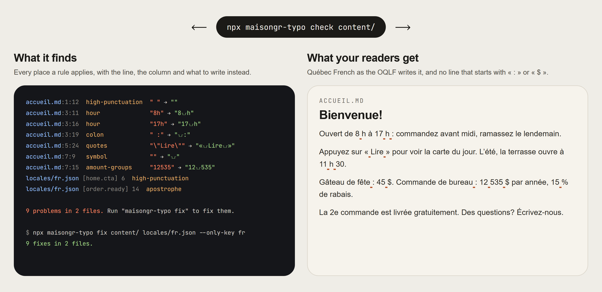

# maisongr-typo

**French typography, the Québec way.** The no-break spaces, « guillemets », hours, amounts and ordinals the Office québécois de la langue française (OQLF) prescribes, applied to text, Markdown, HTML and JSON translation files. France's rules on request. A `check` command keeps new copy in line in CI.

[](https://www.npmjs.com/package/maisongr-typo)
[](https://github.com/maison-gr/maisongr-typo/actions/workflows/ci.yml)
[](LICENSE)




```js
import { typeset } from "maisongr-typo";

typeset(`Vraiment ? "Ouvert" de 8h30 à 22h : 29$, 12535 $ et 15%. L'été... la 2ème fois !`);
// Vraiment? « Ouvert » de 8 h 30 à 22 h : 29 $, 12 535 $ et 15 %. L’été… la 2e fois!
```

The spaces it adds or replaces are no-break spaces (U+00A0), so « 29 $ », « 8 h 30 » and « Note : » never break across two lines.

## Why

French puts spaces where English doesn't, and some of them must never break: a line that starts with « : », « $ » or « » » looks broken. Most French typography tools apply France's rules, which put a space before `;`, `!` and `?`. Québec doesn't:

> « L'Office québécois de la langue française opte pour l'absence d'espace devant le point-virgule, le point d'exclamation et le point d'interrogation. »
> [OQLF, Banque de dépannage linguistique](https://vitrinelinguistique.oqlf.gouv.qc.ca/22039/la-typographie/espacement/espacement-avant-et-apres-les-signes-de-ponctuation-et-les-symboles)

This package follows the OQLF by default (`fr-CA`), and France with `locale: "fr-FR"`. It's built from the typography of the [Maison GR](https://www.maisongr.com) products, where it keeps thousands of interface strings in line.

## Install

```sh
npm install maisongr-typo
```

Or, without installing, on your files:

```sh
npx maisongr-typo check content/
```

## The rules

| Rule | Before | After (fr-CA) | OQLF source |
|---|---|---|---|
| `high-punctuation` | `Vraiment ?` | `Vraiment?` | [22039](https://vitrinelinguistique.oqlf.gouv.qc.ca/22039/la-typographie/espacement/espacement-avant-et-apres-les-signes-de-ponctuation-et-les-symboles) |
| `colon` | `Note: texte` | `Note : texte` | 22039 |
| `guillemet-open`, `guillemet-close` | `«Bonjour»` | `« Bonjour »` | 22039 |
| `quotes` | `"Bonjour"` | `« Bonjour »` | 22039 |
| `hour` | `8h30`, `22H` | `8 h 30`, `22 h` | [21516](https://vitrinelinguistique.oqlf.gouv.qc.ca/21516/la-typographie/nombres/ecriture-des-heures) |
| `colon-hour` (option) | `8:30` | `8 h 30` | 21516 |
| `symbol` | `29$`, `15%`, `20°C` | `29 $`, `15 %`, `20 °C` | 22039, [21401](https://vitrinelinguistique.oqlf.gouv.qc.ca/21401/les-abreviations-et-les-symboles/les-symboles/ecriture-des-symboles-dunites-de-mesure) |
| `dollar-after` | `$29` | `29 $` | [21584](https://vitrinelinguistique.oqlf.gouv.qc.ca/21584/la-typographie/nombres/ecriture-des-sommes-dargent) |
| `amount-groups` | `12535,75 $` | `12 535,75 $` | [25447](https://vitrinelinguistique.oqlf.gouv.qc.ca/25447/la-typographie/nombres/espacements-dans-les-nombres) |
| `digit-groups` | `3 000` (ordinary space) | `3 000` (no-break) | [24566](https://vitrinelinguistique.oqlf.gouv.qc.ca/24566/la-typographie/espacement/contextes-exigeant-une-espace-insecable) |
| `ordinal` | `2ème`, `1ère`, `1ier` | `2e`, `1re`, `1er` | |
| `apostrophe` | `l'été` | `l’été` | |
| `ellipsis` | `...` | `…` | |
| `space-before-comma` | `oui , merci .` | `oui, merci.` | 22039 |

Spaces before `:` and inside « » are no-break spaces (U+00A0). Each rule replaces the spaces next to what it targets, or adds the one that's missing; it never rewrites words.

## fr-CA and fr-FR

| | `fr-CA` (default) | `fr-FR` |
|---|---|---|
| Before `;` `!` `?` | Nothing (`highPunctuation: "none"`), or a narrow no-break space with `highPunctuation: "narrow"`, which the OQLF accepts | Narrow no-break space (U+202F) |
| Before `:`, inside « » | No-break space | No-break space |
| Between digit groups | No-break space | Narrow no-break space |
| Hours, symbols, ordinals | 8 h 30, 29 $, 2e | 8 h 30, 29 €, 2e |

## In code

```js
import { typeset, check } from "maisongr-typo";

typeset("Prêt ? Oui !");                                  // "Prêt? Oui!"
typeset("Prêt? Oui!", { locale: "fr-FR" });              // "Prêt ? Oui !" (narrow no-break spaces)
typeset(markdown, { format: "markdown" });               // text only: never code, link targets or front matter
typeset(html, { format: "html" });                       // text nodes only: never tags, attributes, <code>, <pre>, <script>
typeset("Bienvenue chez Toqué!", { keep: ["Toqué!"] });  // a brand's spelling stays as written

check("Il est 8h30 : 29$");
// [
//   { rule: "hour",   line: 1, column: 8,  found: "8h30", expected: "8 h 30", message: "Write the hour with…", index: 7, length: 4 },
//   { rule: "colon",  line: 1, column: 12, found: " :",   expected: " :",     … },
//   { rule: "symbol", line: 1, column: 17, found: "",     expected: " ",      … }
// ]
```

`typeset` is pure and idempotent: running it twice gives the same text, and `check` returns an empty list for anything `typeset` produced.

### Options

| Option | Default | What it does |
|---|---|---|
| `locale` | `"fr-CA"` | `"fr-CA"` (OQLF) or `"fr-FR"` |
| `format` | `"text"` | `"text"`, `"markdown"` or `"html"` |
| `highPunctuation` | `"none"` | fr-CA only: `"narrow"` puts a narrow no-break space before `;` `!` `?` |
| `quotes` | `true` | `"…"` becomes `« … »` |
| `apostrophes` | `true` | `'` between letters becomes `’` |
| `ellipsis` | `true` | `...` becomes `…` |
| `hours` | `true` | `8h30` becomes `8 h 30` |
| `colonHours` | `false` | `8:30` becomes `8 h 30` too (the OQLF accepts `8:30` in tables and technical text) |
| `ordinals` | `true` | `2ème` becomes `2e` |
| `dollarAfter` | `true` | `$29` becomes `29 $` (whole amounts, or with a decimal comma) |
| `groupFourDigits` | `false` | `1490 $` becomes `1 490 $` (optional for four digits, per the OQLF) |
| `keep` | `[]` | Spellings to leave as written, such as brand names |

## From the command line

```sh
npx maisongr-typo check content/ README.fr.md   # list what needs fixing; exits 1 if anything does
npx maisongr-typo fix content/                   # fix the files in place
npx maisongr-typo < in.txt > out.txt             # standard input to standard output
```

```text
content/accueil.md:3:11  hour  "8h" → "8⍽h"  Write the hour with the symbol h and no-break spaces: 8 h 30, 22 h.
content/accueil.md:3:19  colon  " :" → "⍽:"  Put a no-break space before the colon: Note : texte.
2 problems in 1 file. Run "maisongr-typo fix" to fix them.
```

`⍽` marks a no-break space and `⸱` a narrow one in reports. The CLI reads `.md`, `.mdx`, `.markdown`, `.html`, `.htm` and `.txt` files, and searches folders for them, skipping `node_modules`, `.git` and build output. Options: the ones above as flags (`--locale fr-FR`, `--narrow`, `--keep "Toqué!,Yahoo!"`, `--colon-hours`, `--group-four-digits`, `--no-quotes`…), `--json` for a machine-readable report, and `--help`.

### Translation files

A JSON file named on the command line has its string values typeset, never its keys. `--only-key fr` limits it to the strings under a key named `fr`, so a file holding both languages keeps its English as written:

```sh
npx maisongr-typo check locales/fr.json
npx maisongr-typo fix messages.json --only-key fr
```

A file with nothing to fix is left byte for byte; a fixed one keeps its indentation and line endings.

## In CI

```yaml
- run: npx maisongr-typo check content/ locales/fr.json
```

It fails the build on new copy that breaks the rules, and the report says where and what to write instead.

## What it never touches

- Links, emails and bare domains: `https://exemple.ca/a?b=1`, `info@exemple.ca`, `maisongr.com/fr`. Punctuation right after a link stays apart from it, so `Voir https://exemple.ca !` keeps its space.
- HTML entities (`&amp;`, `&nbsp;`) and the spellings in `keep`.
- In Markdown: front matter, fenced and inline code, link targets and titles, reference definitions, autolinks and HTML tags.
- In HTML: tags and attributes, comments, and the contents of `<pre>`, `<code>`, `<kbd>`, `<samp>`, `<var>`, `<textarea>`, `<script>`, `<style>`, `<svg>` and `<math>`.
- English amounts (`$29.99`) and identifiers, years and street numbers (`562498`, `2026`, `10985, rue des Érables`): only amounts with a symbol are grouped.

## For AI agents

The package ships an [Agent Skill](skills/maisongr-typo/SKILL.md) that tells a coding agent when and how to run it, and an [`llms.txt`](llms.txt). With Claude Code, Codex, Cursor or any agent that reads skills, copy `skills/maisongr-typo` into the project's skills folder.

## Limits

- It assumes the text is French. Run it on French copy only (in JSON, `--only-key fr` helps).
- It doesn't correct spelling, accents, capitals or grammar, or choose between `8 h 05` and `8 h 5`: it keeps what you wrote.
- Ordinals are fixed for numbers written in digits; `1ème` is left alone, since `1er` or `1re` depends on the gender.
- In HTML, the no-break spaces it adds are characters (U+00A0, U+202F), not `&nbsp;`. Serve the page as UTF-8.

## Requirements

Node.js 20.9 or later, on Linux, macOS and Windows. No runtime dependencies. An ES module: from CommonJS, `require("maisongr-typo")` works on Node 22.12 and later; on Node 20, use `await import("maisongr-typo")`. The CLI works the same everywhere.

## More from Maison GR

Open source from [Maison GR](https://www.maisongr.com), a software studio in Québec City:

- [maisongr-sitemap](https://github.com/maison-gr/maisongr-sitemap): one sitemap, two readers. The XML search engines need, and a page in your site's own design for people.
- [Maison GR Sitemap for WordPress](https://github.com/maison-gr/maisongr-sitemap-wordpress): the same sitemap for WordPress, in your theme's colours and type.
- [maisongr-skills](https://github.com/maison-gr/maisongr-skills): one engineering standard for every AI coding agent: Claude Code, Codex, Cursor, Copilot, Gemini CLI.
- [maisongr-law25](https://github.com/maison-gr/maisongr-law25): your Law 25 privacy impact assessment, next to your code, checked in CI.

## License

MIT, © Maison GR Inc. The rules cite the OQLF's Banque de dépannage linguistique; its pages are the authority, and this package is not affiliated with the OQLF.
