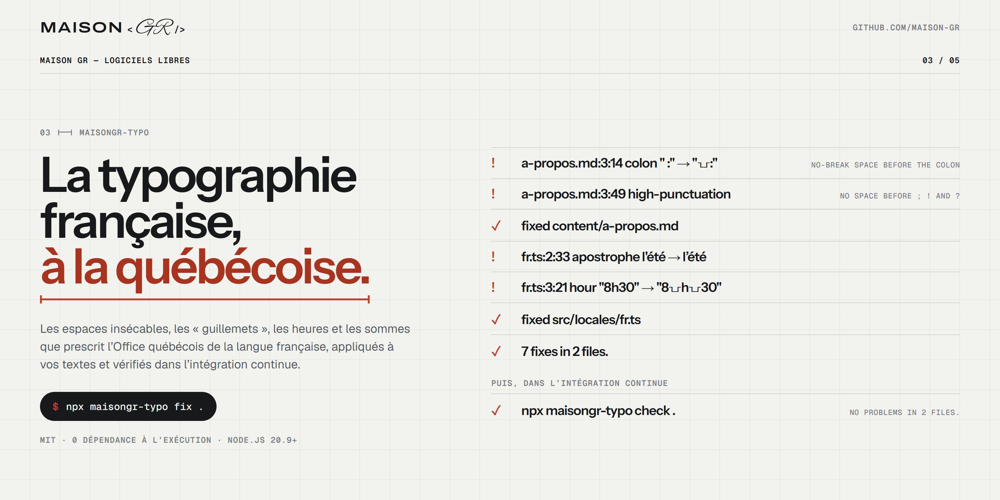

# maisongr-typo

**Français** · [English](README.en.md)

**La typographie française, à la québécoise.** Les espaces insécables, les « guillemets », les heures, les sommes et les ordinaux que prescrit l’Office québécois de la langue française (OQLF), appliqués au texte, au Markdown, au HTML, aux fichiers de traduction (JSON, iOS, Android, gettext, XLIFF, YAML, Java, Flutter) et aux chaînes françaises du code JavaScript et TypeScript. Les règles de la France sur demande. Une commande `check` garde les nouveaux textes conformes dans la CI.

[](https://www.npmjs.com/package/maisongr-typo)
[](https://github.com/maison-gr/maisongr-typo/actions/workflows/ci.yml)
[](LICENSE)




```js
import { typeset } from "maisongr-typo";

typeset(`Vraiment ? "Ouvert" de 8h30 à 22h : 29$, 12535 $ et 15%. L'été... la 2ème fois !`);
// Vraiment? « Ouvert » de 8 h 30 à 22 h : 29 $, 12 535 $ et 15 %. L’été… la 2e fois!
```

Les espaces qu’il ajoute ou remplace sont insécables (U+00A0) : « 29 $ », « 8 h 30 » et « Note : » ne se coupent jamais en fin de ligne.

## Pourquoi

Le français met des espaces là où l’anglais n’en met pas, et certaines ne doivent jamais se couper : une ligne qui commence par « : », « $ » ou « » » a l’air cassée. La plupart des outils de typographie française appliquent les règles de la France, qui mettent une espace devant `;`, `!` et `?`. Pas le Québec :

> « L’Office québécois de la langue française opte pour l’absence d’espace devant le point-virgule, le point d’exclamation et le point d’interrogation. »
> [OQLF, Banque de dépannage linguistique](https://vitrinelinguistique.oqlf.gouv.qc.ca/22039/la-typographie/espacement/espacement-avant-et-apres-les-signes-de-ponctuation-et-les-symboles)

Ce paquet suit l’OQLF par défaut (`fr-CA`), et la France avec `locale: "fr-FR"`. Il est tiré de la typographie des produits de [Maison GR](https://www.maisongr.com), où il garde des milliers de textes d’interface conformes.

## Installation

```sh
npm install maisongr-typo
```

Ou, sans rien installer, sur vos fichiers :

```sh
npx maisongr-typo check content/
```

## Les règles

| Règle | Avant | Après (fr-CA) | Source OQLF |
|---|---|---|---|
| `high-punctuation` | `Vraiment ?` | `Vraiment?` | [22039](https://vitrinelinguistique.oqlf.gouv.qc.ca/22039/la-typographie/espacement/espacement-avant-et-apres-les-signes-de-ponctuation-et-les-symboles) |
| `colon` | `Note: texte` | `Note : texte` | 22039 |
| `guillemet-open`, `guillemet-close` | `«Bonjour»` | `« Bonjour »` | 22039 |
| `quotes` | `"Bonjour"` | `« Bonjour »` | 22039 |
| `hour` | `8h30`, `22H` | `8 h 30`, `22 h` | [21516](https://vitrinelinguistique.oqlf.gouv.qc.ca/21516/la-typographie/nombres/ecriture-des-heures) |
| `colon-hour` (option) | `8:30` | `8 h 30` | 21516 |
| `symbol` | `29$`, `15%`, `20°C` | `29 $`, `15 %`, `20 °C` | 22039, [21401](https://vitrinelinguistique.oqlf.gouv.qc.ca/21401/les-abreviations-et-les-symboles/les-symboles/ecriture-des-symboles-dunites-de-mesure) |
| `dollar-after` | `$29` | `29 $` | [21584](https://vitrinelinguistique.oqlf.gouv.qc.ca/21584/la-typographie/nombres/ecriture-des-sommes-dargent) |
| `amount-groups` | `12535,75 $` | `12 535,75 $` | [25447](https://vitrinelinguistique.oqlf.gouv.qc.ca/25447/la-typographie/nombres/espacements-dans-les-nombres) |
| `digit-groups` | `3 000` (espace ordinaire) | `3 000` (insécable) | [24566](https://vitrinelinguistique.oqlf.gouv.qc.ca/24566/la-typographie/espacement/contextes-exigeant-une-espace-insecable) |
| `ordinal` | `2ème`, `1ère`, `1ier` | `2e`, `1re`, `1er` | |
| `apostrophe` | `l'été` | `l’été` | |
| `ellipsis` | `...` | `…` | |
| `space-before-comma` | `oui , merci .` | `oui, merci.` | 22039 |

Les espaces devant `:` et à l’intérieur des « » sont insécables (U+00A0). Chaque règle remplace les espaces voisines de ce qu’elle vise, ou ajoute celle qui manque; elle ne réécrit jamais de mots.

## fr-CA et fr-FR

| | `fr-CA` (par défaut) | `fr-FR` |
|---|---|---|
| Devant `;` `!` `?` | Rien (`highPunctuation: "none"`), ou une espace fine insécable avec `highPunctuation: "narrow"`, que l’OQLF accepte | Espace fine insécable (U+202F) |
| Devant `:`, dans les « » | Espace insécable | Espace insécable |
| Entre les tranches de chiffres | Espace insécable | Espace fine insécable |
| Heures, symboles, ordinaux | 8 h 30, 29 $, 2e | 8 h 30, 29 €, 2e |

## Dans le code

```js
import { typeset, check } from "maisongr-typo";

typeset("Prêt ? Oui !");                                  // "Prêt? Oui!"
typeset("Prêt? Oui!", { locale: "fr-FR" });              // "Prêt ? Oui !" (espaces fines insécables)
typeset(markdown, { format: "markdown" });               // le texte seulement : jamais le code, les liens ni l’en-tête
typeset(html, { format: "html" });                       // les nœuds texte seulement : jamais les balises, attributs, <code>, <pre>, <script>
typeset("Bienvenue chez Toqué!", { keep: ["Toqué!"] });  // la graphie d’une marque reste telle quelle

check("Il est 8h30 : 29$");
// [
//   { rule: "hour",   line: 1, column: 8,  found: "8h30", expected: "8 h 30", message: "Write the hour with…", index: 7, length: 4 },
//   { rule: "colon",  line: 1, column: 12, found: " :",   expected: " :",     … },
//   { rule: "symbol", line: 1, column: 17, found: "",     expected: " ",      … }
// ]
```

`typeset` est pure et idempotente : l’appliquer deux fois donne le même texte, et `check` renvoie une liste vide pour tout ce que `typeset` a produit.

### Options

| Option | Par défaut | Effet |
|---|---|---|
| `locale` | `"fr-CA"` | `"fr-CA"` (OQLF) ou `"fr-FR"` |
| `format` | `"text"` | `"text"`, `"markdown"` ou `"html"` |
| `highPunctuation` | `"none"` | fr-CA seulement : `"narrow"` met une espace fine insécable devant `;` `!` `?` |
| `quotes` | `true` | `"…"` devient `« … »` |
| `apostrophes` | `true` | `'` entre deux lettres devient `’` |
| `ellipsis` | `true` | `...` devient `…` |
| `hours` | `true` | `8h30` devient `8 h 30` |
| `colonHours` | `false` | `8:30` devient aussi `8 h 30` (l’OQLF accepte `8:30` dans les tableaux et les textes techniques) |
| `ordinals` | `true` | `2ème` devient `2e` |
| `dollarAfter` | `true` | `$29` devient `29 $` (sommes entières, ou avec une virgule décimale) |
| `groupFourDigits` | `false` | `1490 $` devient `1 490 $` (facultatif pour quatre chiffres, selon l’OQLF) |
| `keep` | `[]` | Graphies à laisser telles quelles, comme des noms de marque |

## En ligne de commande

```sh
npx maisongr-typo check content/ README.fr.md   # liste ce qui est à corriger; code de sortie 1 s'il y a quoi que ce soit
npx maisongr-typo fix content/                   # corrige les fichiers sur place
npx maisongr-typo < in.txt > out.txt             # de l'entrée standard vers la sortie standard
```

```text
content/accueil.md:3:11  hour  "8h" → "8⍽h"  Write the hour with the symbol h and no-break spaces: 8 h 30, 22 h.
content/accueil.md:3:19  colon  " :" → "⍽:"  Put a no-break space before the colon: Note : texte.
2 problems in 1 file. Run "maisongr-typo fix" to fix them.
```

Les messages de l’outil sont en anglais, comme la plupart des outils de développement. Dans les rapports, `⍽` marque une espace insécable et `⸱` une espace fine. L’outil lit les fichiers `.md`, `.mdx`, `.markdown`, `.html`, `.htm` et `.txt`, et les cherche dans les dossiers en sautant `node_modules`, `.git` et les dossiers de compilation. Options : celles ci-dessus en drapeaux (`--locale fr-FR`, `--narrow`, `--keep "Toqué!,Yahoo!"`, `--colon-hours`, `--group-four-digits`, `--no-quotes`…), `--json` pour un rapport lisible par une machine, `--github` pour des annotations GitHub Actions, et `--help`.

### Fichiers de traduction

Un fichier JSON nommé sur la ligne de commande voit ses valeurs texte corrigées, jamais ses clés. `--only-key fr` s’en tient aux textes sous une clé nommée `fr`, pour qu’un fichier qui contient les deux langues garde son anglais tel quel :

```sh
npx maisongr-typo check locales/fr.json
npx maisongr-typo fix messages.json --only-key fr
```

Un fichier sans rien à corriger reste identique octet pour octet; un fichier corrigé garde son indentation et ses fins de ligne.

### JavaScript et TypeScript

Le texte français d’une application vit souvent dans son code. Dans un fichier `.js`, `.jsx`, `.ts`, `.tsx`, `.mjs`, `.cjs`, `.mts` ou `.cts`, seules les chaînes de caractères françaises sont corrigées; le code reste identique octet pour octet. Une chaîne est française quand elle est :

- dans un fichier français : `fr.ts`, `fr-CA.js`, `messages.fr.ts`, ou un dossier `fr/`;
- sous une clé `fr` (`{ fr: { … }, en: { … } }`), à n’importe quelle profondeur;
- ailleurs, quand elle se lit en français : `isFr ? 'Gérer les cookies' : 'Manage cookies'`.

Les clés, les chemins d’import, les expressions `${…}` et les expressions régulières ne sont jamais touchés. Le HTML d’une chaîne (un gabarit de courriel) est corrigé comme du HTML : ses balises et ses attributs restent tels quels, même quand un `${…}` les coupe.

```sh
npx maisongr-typo check src/lib/translations      # les fichiers français d’un dossier
npx maisongr-typo check src --code                # tout le code d’un dossier, ses chaînes françaises seulement
```

Dans un dossier, les fichiers de test (`*.test.ts`, `__tests__/`…) ne sont jamais lus comme du code : leurs chaînes sont ce qu’ils comparent.

### iOS, Android et les autres formats de traduction

| Plateforme | Fichier | Ce qui est corrigé |
|---|---|---|
| iOS, macOS | `fr.lproj/Localizable.strings` | les valeurs, jamais les clés ni les commentaires |
| Xcode | `Localizable.xcstrings` | les localisations françaises seulement (`fr`, `fr-CA`), pluriels compris |
| Android | `res/values-fr/strings.xml` | `<string>`, `<plurals>`, `<string-array>`; `translatable="false"` et CDATA laissés tels quels |
| gettext | `fr.po`, `fr/LC_MESSAGES/*.po` | les `msgstr`, jamais les `msgid` ni l’en-tête |
| XLIFF | `.xlf`, `.xliff` | les `<target>`, jamais les `<source>` |
| YAML (Rails, i18next…) | `config/locales/fr.yml` | les valeurs, en clair, entre guillemets ou en bloc |
| Java | `messages_fr.properties` | les valeurs; les `\u00e9` restent des `\u` dans un fichier ASCII |
| Flutter | `app_fr.arb` | les messages, jamais les métadonnées `@` ni la syntaxe ICU |

Un fichier est français par son chemin (`fr.lproj/`, `values-fr/`, `fr/`, `_fr`, `fr.yml`) ou par ce qu’il déclare (`Language: fr` d’un `.po`, `target-language` d’un XLIFF, `@@locale` d’un `.arb`, la racine `fr:` d’un YAML). Un fichier d’une autre langue reste identique octet pour octet, et un fichier corrigé ne change que ses textes : chaque format garde ses échappements (`\'` d’Android, `\"` d’iOS, `''` de MessageFormat). Dans un dossier, les fichiers de traduction français sont trouvés, et les `.xcstrings` toujours.

```sh
npx maisongr-typo check ios/ android/app/src/main/res config/locales
```

## Dans la CI

```yaml
- run: npx maisongr-typo check content/ locales/fr.json src/lib/translations
```

La compilation échoue sur un nouveau texte qui enfreint les règles, et le rapport dit où, et quoi écrire à la place. Ou, sans script à écrire :

**Action GitHub.** Chaque problème s’affiche sur sa ligne dans la demande de tirage (pull request).

```yaml
- uses: actions/checkout@v5
- uses: maison-gr/maisongr-typo@v1.0.5
  with:
    paths: content/ locales/fr.json src/lib/translations
    # locale: fr-FR · narrow: true · code: true · keep: "Toqué!" · only-key: fr · command: fix
```

L’action lance la version npm de son étiquette (`version` pour en choisir une autre) et demande Node.js 20.9 ou plus sur l’exécuteur, ce qu’ont ceux de GitHub. Ailleurs, `npx maisongr-typo check … --github` affiche les mêmes annotations.

**pre-commit.** Dans `.pre-commit-config.yaml` :

```yaml
repos:
  - repo: https://github.com/maison-gr/maisongr-typo
    rev: v1.0.5
    hooks:
      - id: maisongr-typo        # ou maisongr-typo-fix, qui corrige les fichiers
        # files: ^contenu/      # vos textes français, si leurs chemins ne disent pas fr
```

Un fichier nommé sur la ligne de commande est lu comme du français; par défaut, le crochet ne reçoit donc que les fichiers dont le chemin dit français : `fr/…`, `fr.json`, `*.fr.md`, `fr.lproj/`, `values-fr/`, `fr.po`, `fr.yml`, `*_fr.properties`, `app_fr.arb`, et les `.xcstrings`. Les fichiers JavaScript, TypeScript et de traduction peuvent s’y ajouter, quelle que soit leur langue : seul leur texte français est lu.

**Docker,** pour toute CI ou une machine sans Node.js (linux/amd64 et linux/arm64) :

```sh
docker run --rm -v "$PWD:/work" ghcr.io/maison-gr/maisongr-typo check contenu/
docker run --rm --user "$(id -u):$(id -g)" -v "$PWD:/work" ghcr.io/maison-gr/maisongr-typo fix contenu/
```

## Ce qu’il ne touche jamais

- Les liens, les courriels et les noms de domaine : `https://exemple.ca/a?b=1`, `info@exemple.ca`, `maisongr.com/fr`. La ponctuation juste après un lien reste détachée de lui, donc `Voir https://exemple.ca !` garde son espace.
- Les entités HTML (`&amp;`, `&nbsp;`) et les graphies de `keep`.
- En Markdown : l’en-tête (front matter), le code en bloc et en ligne, la cible et le titre des liens, les définitions de référence, les liens automatiques et les balises HTML.
- En HTML : les balises et les attributs, les commentaires, et le contenu de `<pre>`, `<code>`, `<kbd>`, `<samp>`, `<var>`, `<textarea>`, `<script>`, `<style>`, `<svg>` et `<math>`.
- Les sommes à l’anglaise (`$29.99`), les identifiants, les années et les numéros civiques (`562498`, `2026`, `10985, rue des Érables`) : seules les sommes suivies d’un symbole sont groupées.

## Pour les agents d’IA

Le paquet fournit une [Agent Skill](skills/maisongr-typo/SKILL.md) qui dit à un agent de programmation quand et comment le lancer, et un [`llms.txt`](llms.txt). Avec Claude Code, Codex, Cursor ou tout agent qui lit les skills, copiez `skills/maisongr-typo` dans le dossier des skills du projet.

## Limites

- Il suppose que le texte est en français. Lancez-le sur du texte français seulement (en JSON, `--only-key fr` aide; dans le code, seules les chaînes françaises sont lues).
- Il ne corrige ni l’orthographe, ni les accents, ni les majuscules, ni la grammaire, et ne choisit pas entre `8 h 05` et `8 h 5` : il garde ce que vous avez écrit.
- Les ordinaux sont corrigés pour les nombres écrits en chiffres; `1ème` est laissé tel quel, puisque `1er` ou `1re` dépend du genre.
- En HTML, les espaces insécables qu’il ajoute sont des caractères (U+00A0, U+202F), pas des `&nbsp;`. Servez la page en UTF-8.

## Prérequis

Node.js 20.9 ou plus récent, sur Linux, macOS et Windows. Aucune dépendance à l’exécution. Un module ES : depuis CommonJS, `require("maisongr-typo")` fonctionne à partir de Node 22.12; sur Node 20, utilisez `await import("maisongr-typo")`. L’outil en ligne de commande fonctionne partout de la même façon.

## Aussi chez Maison GR

Du logiciel libre de [Maison GR](https://www.maisongr.com), un studio de logiciels de Québec :

- [maisongr-sitemap](https://github.com/maison-gr/maisongr-sitemap) : un plan de site, deux lecteurs. Le XML dont les moteurs de recherche ont besoin, et une page aux couleurs de votre site pour les gens.
- [Maison GR Sitemap pour WordPress](https://github.com/maison-gr/maisongr-sitemap-wordpress) : le même plan de site pour WordPress, aux couleurs et aux polices de votre thème.
- [maisongr-skills](https://github.com/maison-gr/maisongr-skills) : une même norme d’ingénierie pour tous les agents de programmation par IA : Claude Code, Codex, Cursor, Copilot, Gemini CLI.
- [maisongr-law25](https://github.com/maison-gr/maisongr-law25) : votre évaluation des facteurs relatifs à la vie privée (Loi 25), à côté de votre code, vérifiée dans la CI.

## Licence

MIT, © Maison GR Inc. Les règles citent la Banque de dépannage linguistique de l’OQLF; ses pages font autorité, et ce paquet n’est pas affilié à l’OQLF.
